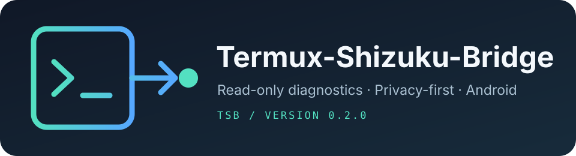

# ترموکس–شیزوکو بریج (TSB)

**ابزار تشخیصی محلی و حریم‌خصوصی‌محور برای ارتباط Termux، rish و Shizuku**

[English](README.en.md) · [فارسی](README.fa.md)

## معرفی

TSB مجموعه‌ای محلی و متن‌باز با دو بخش مکمل است:

- **TSB CLI:** ابزار پایتونی برای بررسی محیط Termux، ابزار رسمی rish، فایل DEX همراه و تعداد محدودی probe ثابت و فقط‌خواندنی.
- **TSB Mobile:** اپ بومی اندروید با Kotlin و Jetpack Compose. این اپ نصب بودن Termux و Shizuku و دسترسی Binder شیزوکو را بررسی می‌کند، اطلاعات دستگاه را نشان می‌دهد، راهنمای راه‌اندازی دارد و گزارش محلی کپی می‌کند.

نسخهٔ فعلی اپ موبایل وجود rish، فایل DEX همراه، UID راه‌دور یا اجرای فرمان از راه دور را بررسی نمی‌کند. برای این موارد از CLI استفاده کنید.

## امکانات

### ابزار خط فرمان
- تشخیص محیط و نسخهٔ Termux
- پیدا کردن rish و فایل DEX همراه
- اجرای probeهای ثابت، مجازشده و فقط‌خواندنی
- تشخیص UID راه‌دور بدون فرض روت بودن
- گزارش متنی و JSON با پالایش اطلاعات حساس
- اجرای محلی بدون تله‌متری یا بارگذاری خودکار

### اپ اندروید
- تغییر زبان فارسی و انگلیسی و ذخیرهٔ انتخاب کاربر
- تشخیص نصب بودن برنامه‌های Termux و Shizuku
- بررسی دسترسی Binder با API و Provider رسمی Shizuku
- نمایش نسخهٔ اندروید، سطح API، سازنده و مدل دستگاه
- راهنمای گام‌به‌گام و میانبر بازکردن برنامه‌ها
- گزارش تشخیصی در حافظهٔ موقت همراه با توضیح محدودیت‌ها
- بدون درخواست مجوز ممتاز Shizuku، اجرای shell، مجوز اینترنت یا تله‌متری

## نصب CLI

پیش‌نیازها: اندروید همراه Termux، پایتون ۳٫۱۰ یا جدیدتر، Shizuku فعال، مجاز بودن Termux در Shizuku و ابزار رسمی rish به‌همراه فایل rish_shizuku.dex.

~~~bash
pkg update && pkg upgrade
pkg install python git
git clone https://github.com/M34nX/Termux-Shizuku-Bridge.git
cd Termux-Shizuku-Bridge
python -m pip install .
~~~

اجرا:

~~~bash
tsb doctor
tsb status
tsb report
tsb report --json
tsb report --output tsb-report.txt
tsb version
~~~

اجرای مستقیم از سورس بدون نصب:

~~~bash
PYTHONPATH=src python -m tsb doctor
~~~

## اپلیکیشن اندروید

راهنمای ساخت: [android/README.md](android/README.md) و [راهنمای فارسی](android/README.fa.md).

- حداقل نسخهٔ اندروید: **API 24**؛ وابستگی انتخاب‌شدهٔ Shizuku به این سطح نیاز دارد.
- محیط ساخت: JDK 17، Android SDK 35 و Gradle 8.9.
- دستور ساخت در پوشهٔ android/: gradle :app:assembleDebug.
- CI پس از موفقیت ساخت اندروید، فایل APK آزمایشی و نسخهٔ بتای GitHub را منتشر می‌کند.

APK آزمایشی، نسخهٔ Play Store یا نسخهٔ امضاشدهٔ انتشار عمومی نیست. پیش از نصب، کد را بررسی کنید و فقط نسخه‌هایی را نصب کنید که به آن‌ها اعتماد دارید.

## حریم خصوصی و ایمنی

- CLI فقط فرمان‌های ثابت موجود در فهرست مجاز داخلی را اجرا می‌کند؛ ورودی کاربر به فرمان shell تزریق نمی‌شود.
- اپ فقط وضعیت دیده‌شدن بسته‌ها و دسترسی Binder را می‌خواند و درخواست دسترسی ممتاز Shizuku نمی‌کند.
- گزارش‌ها فقط در حافظهٔ موقت دستگاه کپی می‌شوند و بارگذاری نمی‌شوند.
- تله‌متری، اجرای فرمان دلخواه، اعطای مجوز یا تغییر تنظیمات اندروید وجود ندارد.

## مستندات

- [معماری](docs/ARCHITECTURE.md)
- [مدل امنیتی](docs/SECURITY.md)
- [عیب‌یابی](docs/TROUBLESHOOTING.md)
- [سازگاری](docs/COMPATIBILITY.md)
- [مستندات فارسی](docs/fa/)

## وضعیت پروژه

TSB CLI و TSB Mobile در نسخهٔ ۰٫۲٫۱ هستند. CI پایتون و ساخت اندروید جداگانه بررسی می‌شوند. APK اندروید همچنان debug و آزمایشی است، نه نسخهٔ انتشار عمومی یا امضاشدهٔ تولیدی. آزمایش روی دستگاه واقعی لازم است؛ دسترسی Binder به‌تنهایی به معنای سالم بودن کامل اتصال rish نیست.

## مجوز

MIT؛ متن کامل در [LICENSE](LICENSE) قرار دارد.
