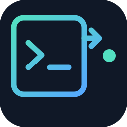

# Termux-Shizuku-Bridge

**Read-only diagnostics for the Termux → rish → Shizuku connection.**

*Understand your bridge. Keep control local.*

   

---

## What is TSB?

**Termux-Shizuku-Bridge (TSB)** is a privacy-first diagnostic utility for checking the local Termux environment and the remote connection provided by Shizuku's official rish helper.

TSB is an observability tool—not a root tool, permission manager, service starter, or Shizuku replacement. It does not grant permissions or change Android settings.

## Features

| Component | What it does |
|---|---|
| Connection checks | Detects Termux, rish, its companion DEX, and fixed read-only probes. |
| Identity fingerprint | Reports the remote UID without assuming Shizuku always means root. |
| Compatibility details | Includes Termux and Python runtime information in diagnostic output. |
| Private reports | Redacts local paths and custom application IDs by default. |
| Local-first operation | No telemetry, automatic uploads, or network reporting. |

## Requirements and compatibility

- Android **7 or newer** for the current Termux app and package environment.
- Official [Termux](https://github.com/termux/termux-app) app. Install Termux and any Termux plugins from the **same distribution source**; do not mix APK signatures from F-Droid, GitHub, or other sources.
- Python **3.10 or newer** (install with pkg install python).
- [Shizuku](https://github.com/RikkaApps/Shizuku) installed, running, and explicitly authorizing Termux.
- The current official rish helper and its rish_shizuku.dex companion, exported using Shizuku's terminal-app integration.

### Current upstream notes

- The Termux project currently lists **v0.118.3** as its latest stable app release and recommends v0.118.0 or newer.
- Shizuku's current release page lists **v13.6.0**, including Android 16 QPR1 support and an updated service-start command.
- Shizuku wireless-debugging startup is supported on Android 11 and newer; the service generally needs to be started again after a reboot on non-rooted devices.
- TSB does not start Shizuku. Its job begins after Shizuku is running and Termux has been authorized.
- The v13.6.0 libshizuku.so service-start change is separate from the rish client helper. Do not rename that service binary to rish or treat it as rish_shizuku.dex.

Compatibility targets are based on upstream documentation and release notes. They are **not a claim of successful testing on every Android device, ROM, or vendor build**. See [Compatibility](docs/COMPATIBILITY.md).

## Installation and first run

### 1. Prepare Termux

Install the current Termux release from one official source and open it. Update packages, then install the prerequisites:

~~~bash
pkg update && pkg upgrade
pkg install python git
python --version
~~~

The Python version must be 3.10 or newer.

### 2. Install and start Shizuku

1. Install Shizuku from its official distribution.
2. On Android 11+, enable Developer options and Wireless debugging in Android settings.
3. Follow Shizuku's official setup guide to pair the device and start the Shizuku service.
4. Confirm that Shizuku shows the service as running.
5. In Shizuku, authorize **Termux** when it appears in the application authorization list.

The pairing and service-start steps are managed by Shizuku and Android, not by TSB. On non-rooted devices, repeat the service-start procedure after a reboot when required.

Official guide: [Shizuku setup](https://shizuku.rikka.app/guide/setup/).

### 3. Export the rish helper

In Shizuku, open its terminal-app integration instructions and export the current rish helper and rish_shizuku.dex companion for Termux. Follow the exact current instructions shown by your installed Shizuku version.

Keep the helper and companion together where possible. TSB looks for rish in ~/rish or PATH, and checks for the companion beside it or in its documented fallback locations. If you use a custom location, set TSB_RISH and/or TSB_RISH_DEX.

**Android 14 and newer:** follow Shizuku's current export instructions. Android restricts execution of writable DEX files through app_process; a writable copy in shared storage may fail. Do not work around this by weakening file or system security.

Official rish usage: [Shizuku-API / rish](https://github.com/RikkaApps/Shizuku-API/tree/master/rish).

### 4. Download and install TSB

Run these commands inside Termux:

~~~bash
git clone https://github.com/M34nX/Termux-Shizuku-Bridge.git
cd Termux-Shizuku-Bridge
python -m pip install .
~~~

If you want to run directly from a source checkout without installing:

~~~bash
PYTHONPATH=src python -m tsb doctor
~~~

### 5. Run diagnostics

~~~bash
tsb doctor
tsb status
tsb report
tsb report --json
tsb report --output tsb-report.txt
tsb version
~~~

Before sharing a report, review it. Paths and non-default application IDs are redacted by default. The --include-paths option is available only when you deliberately need local paths in a report.

## Example output

Output varies by device and Shizuku execution identity. A successful connection may report:

~~~text
TSB 0.2.0 — Termux / Shizuku diagnostics
Overall: READY
Termux detected: yes
rish found: yes
Shizuku DEX found: yes
Remote identity: Android shell
uid: 2000
~~~

This is an illustrative example, not a result from a physical device.

## Troubleshooting

| Symptom | What to check |
|---|---|
| rish found: no | Re-export the official helper from Shizuku's terminal-app integration. Check ~/rish, PATH, or TSB_RISH. |
| DEX not found | Ensure rish_shizuku.dex was exported and is beside rish, or set TSB_RISH_DEX. |
| Permission denied / connection failed | Confirm Shizuku is running and Termux is authorized in Shizuku. |
| Worked before reboot, now unavailable | On non-rooted devices, start Shizuku again using its official setup guide. |
| Android 14+ DEX error | Re-export using the current Shizuku integration instructions; avoid writable DEX files in shared storage. |
| TSB reports an unexpected UID | This is the remote identity actually returned by rish; Shizuku does not imply root. |

See the detailed [Troubleshooting guide](docs/TROUBLESHOOTING.md).

## Commands

| Command | Purpose |
|---|---|
| tsb doctor | Run diagnostics and explain issues. |
| tsb status | Show current connection status. |
| tsb report | Print a sanitized text report. |
| tsb report --json | Print a sanitized JSON report. |
| tsb report --output FILE | Save a report locally. |
| tsb report --include-paths | Explicitly include local paths. |
| tsb version | Show TSB version. |

## Native Android app (TSB Mobile)

A Kotlin + Jetpack Compose companion app is available in [android/](android/). The current MVP checks whether Termux and Shizuku are installed, checks Shizuku binder reachability, provides a setup checklist, and copies a local diagnostic summary.

The mobile MVP does not yet inspect rish or its DEX companion and does not execute remote commands. It makes no network requests, requests no privileged Shizuku permission, and does not upload reports. See [TSB Mobile build instructions](android/README.md).

## Development and tests

~~~bash
python -m pip install -e .
python -m unittest discover -s tests -v
~~~

GitHub Actions runs the unit suite on Python 3.10–3.13. Unit tests do not replace end-to-end checks on physical Android devices with current Termux and Shizuku versions.

## Security and privacy

- Only fixed, hard-coded read-only probes are sent through rish.
- No arbitrary shell command input, eval, or shell=True.
- No permission granting, Android setting changes, app modification, or automatic service startup.
- Every rish subprocess has a timeout.
- Reports stay local unless a user manually shares them.

Read [Security](docs/SECURITY.md) and [Architecture](docs/ARCHITECTURE.md).

## Project status

**Version 0.2.0 — compatibility improvements under review.** Upstream version targets are documented, but physical-device compatibility and CI must be verified before this redesign is described as production-ready.

## License

MIT. See [LICENSE](LICENSE).
